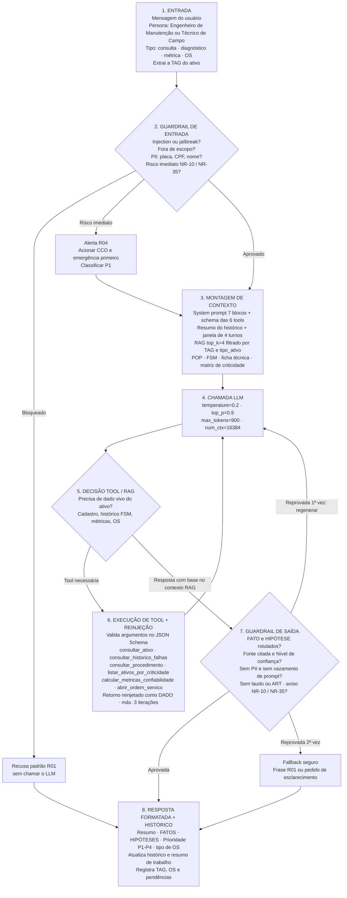

# Decisões Técnicas — EngMan Copilot (Sprint 01)

> Todos os dados citados são **simulados**. As estimativas de tokens usam a heurística de ~3,6 caracteres/token para prosa em português e ~3,1 para JSON; devem ser **validadas com o tokenizer do modelo escolhido** na fase de implementação. Especificações de modelos e licenças devem ser conferidas nas páginas oficiais antes da entrega final.

---

## 1. Arquitetura (8 blocos) — `/docs/arquitetura.png`

O arquivo `/docs/arquitetura.png` é gerado a partir do código Mermaid abaixo (também salvo em `/docs/arquitetura.mmd`). Para exportar o PNG, cole o código em um editor Mermaid (ex.: mermaid.live) e use "Download PNG".

### 1.1 Descrição dos 8 blocos

| Bloco | Função no domínio Motiva | Regras do `system_prompt.md` | Tools / documentos |
|---|---|---|---|
| **1. Entrada com identificação de persona/tipo** | Recebe a mensagem, identifica a persona (Engenheiro de Manutenção ou Técnico de Campo), o tipo de pedido (consulta, diagnóstico, métrica ou OS) e extrai a **TAG** (padrão `TIPO-RODOVIA-KMxxx-NN`). | R11 (ambiguidade), R17 (contexto) | Padrão de TAG em `tools_spec.json` |
| **2. Guardrail de Entrada** | Detecta injection/jailbreak, pedidos fora de escopo, PII (placa, CPF, nome, IP) e risco imediato (fio energizado, queda, acidente). Bloqueia com a frase R01 ou desvia para alerta R04. | R01, R04, R05, R14, R15 | Lista de padrões; `inventario.md` seção 5 |
| **3. Montagem de Contexto** | Monta system prompt (7 blocos), schemas das 6 tools, resumo do histórico + janela de 4 turnos e **RAG** (`top_k = 4`, filtrado por `tag` e `tipo_ativo`, ordenado por `data_vigencia`) de **POP**, **FSM**, ficha técnica e matriz. | R06, R09, R17 | DOC-01 a DOC-14 |
| **4. Chamada LLM** | Inferência com `temperature = 0,2`, `top_p = 0,9`, `max_tokens = 900`, `num_ctx = 16.384` (justificativas na seção 2). | Todas | Modelo via Ollama |
| **5. Decisão de Tool/RAG** | O modelo decide se precisa de **dado vivo** (cadastro do ativo, histórico FSM, métricas, OS) via tool ou se responde com o contexto documental recuperado (RAG). | R07, R08 | 6 tools |
| **6. Execução de Tool + Reinjeção** | Valida os argumentos contra o JSON Schema (enums fechados), executa a tool, trata erros (`ATIVO_NAO_ENCONTRADO`, `HISTORICO_VAZIO`, `TIMEOUT`, `DADOS_INSUFICIENTES`) e reinjeta o retorno **como dado** (delimitado). Máximo de 3 iterações. `abrir_ordem_servico` só executa com confirmação. | R05, R08, R12, R16 | `consultar_ativo`, `consultar_historico_falhas`, `consultar_procedimento`, `listar_ativos_por_criticidade`, `calcular_metricas_confiabilidade`, `abrir_ordem_servico` |
| **7. Guardrail de Saída** | Verifica: FATO/HIPÓTESE rotulados e fonte citada; `Nível de confiança` em diagnósticos; ausência de PII e de vazamento de prompt; ausência de laudo/ART; aviso de segurança quando aplicável; frase R01 exata em recusas. Reprovada: regenera 1 vez; se persistir, fallback seguro. | R02, R03, R05, R06, R10, R14, R18 | Checklist de saída |
| **8. Resposta formatada + gestão de histórico** | Entrega o formato padrão (Resumo, FATOS, HIPÓTESES, Prioridade, Tipo de OS, Próximos passos, Nível de confiança). Atualiza histórico, resumo de trabalho (TAG, OS, pendências) e aplica a política de tokens (seção 5). | R10, R13, R17 | Política de tokens |

---

## 2. Parâmetros de inferência (Tokens e Temperatura)

| Parâmetro | Valor | Justificativa |
|---|---|---|
| `temperature` | **0,2** | Domínio de engenharia e segurança: precisa de respostas estáveis, fiéis às fontes e com recusas **reprodutíveis** (frase exata R01). Valores altos aumentam a chance de inventar TAG, número ou procedimento (alucinação). Não usamos 0,0 porque modelos pequenos podem entrar em repetição e a redação de hipóteses se beneficia de leve variação. |
| `top_p` | **0,9** | Corta a cauda de tokens improváveis sem engessar a resposta; combinado com temperatura baixa mantém a saída previsível. |
| `max_tokens` | **900** | O formato padrão (~350 palavras ≈ 525 tokens) mais folga de ~70% para a estrutura completa (FATOS, HIPÓTESES, passos, confiança) e citações. Limita custo, latência e o risco de respostas longas que estourem o contexto (Risco 8). |
| `num_ctx` | **16.384** | Necessário para acomodar prompt (~5.500), tools (~3.000), RAG, tool return e histórico (seção 5). `num_ctx` de 8.192 **não é suficiente** com a versão completa do prompt. |
| Iterações de tool | **≤ 3** por turno | Evita laços de chamadas e reduz exposição a injection via retornos. |

---

## 3. Comparação de LLMs (3 modelos)

| Critério | **Llama 3.1 8B** (Ollama, local) | **Qwen 2.5 14B** (Ollama, local) | **Gemini 2.5 Flash** (API Google) |
|---|---|---|---|
| Custo | Gratuito (licença comunitária Meta; verificar termos) | Gratuito (verificar licença do tamanho 14B) | Pago por uso, com nível gratuito limitado (verificar condições atuais) |
| Hardware | ~8 GB de RAM/VRAM com quantização 4 bits (aprox. 5 GB de modelo) | ~16 GB de RAM/VRAM com 4 bits (aprox. 9 GB de modelo) | Nenhum (nuvem) |
| Contexto | Até 128k nominal; **16k configurado** | 32k nativo (extensível); **16k configurado** | Janela muito grande (~1M) |
| Tool calling | Suportado (formato nativo Llama 3.1) | Suportado | Suportado (function calling) |
| Português | Bom | Bom a muito bom | Muito bom |
| Seguir instruções longas (prompt de 7 blocos) | Razoável; pode falhar sob prompts muito longos | Melhor aderência a regras e formato JSON | Muito boa |
| Privacidade / LGPD | **Dados não saem da máquina** | **Dados não saem da máquina** | Dados trafegam a terceiro; exige análise de base legal e transferência internacional (LGPD art. 33) |
| Latência | Baixa em GPU, média em CPU | Média a alta em CPU | Baixa |
| **Papel no projeto** | **Padrão** (acessível a todos do grupo) | **Upgrade** se o hardware permitir | Apenas **benchmark com dados simulados** |

**Decisão:** caminho 100% gratuito com **Llama 3.1 8B via Ollama** como padrão; **Qwen 2.5 14B** como alternativa para maior aderência às regras; **Gemini 2.5 Flash** somente como comparação com dado simulado, nunca com dado real. O `sprint1_eval_set.json` serve para comparar os três na fase de implementação.

---

## 4. Vector Stores (2) e embeddings

| Critério | **ChromaDB** | **FAISS** |
|---|---|---|
| Natureza | Banco vetorial embutido com persistência | Biblioteca de busca por similaridade (Meta) |
| Metadados e filtros | **Nativos** (`where` por `tag`, `tipo_ativo`, `tipo_documento`) | Não nativos; exige índice paralelo e lógica própria |
| Persistência | Embutida | Manual (salvar/carregar índice) |
| Desempenho | Suficiente para ~85 chunks (e milhares) | Excelente em grandes volumes (milhões) |
| Simplicidade para o grupo (1º ano) | Alta: API simples | Média: mais código de apoio |
| Custo | Gratuito, open source | Gratuito, open source |

**Decisão: ChromaDB.** O projeto depende de **busca híbrida/filtrada** (ex.: apenas chunks da TAG `CFTV-BR116-KM205-01` e de POPs vigentes), que o Chroma entrega nativamente. Com ~85 chunks, o desempenho bruto do FAISS é irrelevante. FAISS fica como alternativa para escala.

**Embeddings:** `nomic-embed-text` (via Ollama), com prefixos de tarefa de documento e de consulta, pois aceita sequências longas (chunks de ~320 tokens cabem com folga). Alternativa: modelos multilíngues de Sentence Transformers com limite de sequência adequado. Atenção: alguns modelos leves (ex.: variantes MiniLM multilíngues) têm limite de sequência curto (~128 tokens, conforme a documentação do modelo) e **truncariam** os chunks de 320 tokens; por isso não são o padrão.

---

## 5. Política de janela de contexto quantificada (Bônus 5)

**Premissa:** `num_ctx = 16.384` tokens (Llama 3.1 8B ou Qwen 2.5 14B via Ollama). As versões em nuvem têm janela maior, mas o orçamento abaixo vale para o caminho gratuito (o mais restritivo).

### 5.1 Orçamento (pior caso razoável)

| Componente | Cálculo | Tokens (est.) | % de 16.384 |
|---|---|---|---|
| System prompt (versão de execução, sem comentários "Por que este bloco existe" e sem cabeçalho) | ~20.000 caracteres ÷ 3,6 | **~5.500** | 33,6% |
| Schemas das 6 tools (apenas `type` + `function`, sem chaves `x_`) | ~9.300 caracteres ÷ 3,1 | **~3.000** | 18,3% |
| Chunks de RAG | 4 chunks × ~320 + ~30 de metadados e citação por chunk | **~1.400** | 8,5% |
| Retorno de tool (pior caso: histórico com 20 registros) | 20 × ~75 | **~1.500** | 9,2% |
| Histórico: janela de 4 turnos + resumo + fatos fixos | 4 × ~480 + 300 + 100 | **~2.300** | 14,0% |
| Resposta (`max_tokens`) | limite | **900** | 5,5% |
| **Total (pior caso)** | | **~14.600** | **89,1%** |
| **Margem de segurança** | 16.384 − 14.600 | **~1.800** | **10,9%** |

**Caso típico:** 5.500 + 3.000 + 1.400 + 600 (retorno de tool) + 1.200 (histórico) + ~600 (resposta) ≈ **12.300 tokens (75%)**.

**Fixo vs. variável:** ~8.500 tokens (52%) são **fixos** (prompt + tools). Por isso a conversa longa e os retornos de tool são o que precisa ser controlado.

### 5.2 Estratégia de truncamento e resumo

| Gatilho | Ação |
|---|---|
| Sempre | **System prompt e schemas de tools ficam fixos no topo e nunca são truncados** (preservam R01 a R05). |
| Todo turno | RAG é **re-recuperado** a cada turno (`top_k = 4`) e **não** acumula no histórico (só o `chunk_id` citado permanece). |
| Retorno de tool | Limite por tool (`limite` padrão 20, máximo 50). Se o retorno exceder ~1.500 tokens, entregar **agregado** (contagem, datas extremas, padrão horário) em vez de todos os registros. Após usar, o histórico guarda só **1 linha de resumo** (ex.: "FSM: 5 quedas de CFTV-BR116-KM205-01 entre 11 e 16/11, 14h–17h"). |
| Histórico > 4 turnos | Turnos mais antigos são **resumidos** em um *resumo de trabalho* de **≤ 300 tokens** com: TAG(s) em discussão, persona, decisões, OS abertas (ID) e pendências. **Sem PII** (nomes viram função). |
| Contexto total > **80%** (≈ 13.100 tokens) | Disparar resumo antecipado e reduzir `top_k` para 3. |
| Contexto total > **92%** (≈ 15.100 tokens) | **Truncamento emergencial:** descartar os turnos mais antigos (nunca a última mensagem do usuário, o prompt, as tools nem o resumo). |
| Após resumo | O assistente **informa** que usou resumo e **reconfirma a TAG** se houver mais de um ativo em discussão (R17). |

### 5.3 Por que esta política reduz risco

- Evita o truncamento silencioso do início do prompt (onde estão as regras de segurança) por excesso de histórico (**Risco 8**).
- Mantém a TAG e as decisões vivas no resumo, reduzindo erro de ativo (**Risco 1**).
- Limita o custo de cada turno e a exposição a injection por retornos longos (**Risco 2**).

### 5.4 Observações de implementação (fase futura)

- Medir os tokens reais com o tokenizer do modelo e ajustar a tabela.
- Se o hardware não permitir `num_ctx = 16.384`, será necessário usar uma versão compacta do prompt e roteamento de tools por intenção (menos schemas em contexto); esta alternativa **não** faz parte da entrega atual e exigiria nova rodada do `sprint1_eval_set.json`.

---

## 6. Resumo das decisões

| Decisão | Escolha | Motivo principal |
|---|---|---|
| LLM padrão | Llama 3.1 8B (Ollama) | Gratuito, local, privacidade |
| LLM alternativo | Qwen 2.5 14B (Ollama) | Maior aderência a regras e formato |
| Vector store | ChromaDB | Filtros por metadados nativos |
| Embeddings | `nomic-embed-text` | Sequência longa, gratuito, local |
| Chunking | ~320 tokens, overlap ~50 (textos); 1 registro por chunk (FSM, catálogo, boletins) | Preserva passos de segurança e unidade de registro |
| Recuperação | `top_k = 4`, filtro por `tag` e `tipo_ativo`, ordenação por `data_vigencia` | Precisão e apoio ao desempate R09 |
| Inferência | `temperature 0,2`, `top_p 0,9`, `max_tokens 900`, `num_ctx 16.384` | Estabilidade, orçamento de contexto |
| Contexto | Prompt e tools fixos; janela de 4 turnos + resumo ≤ 300 tokens | Evitar truncamento de regras |
